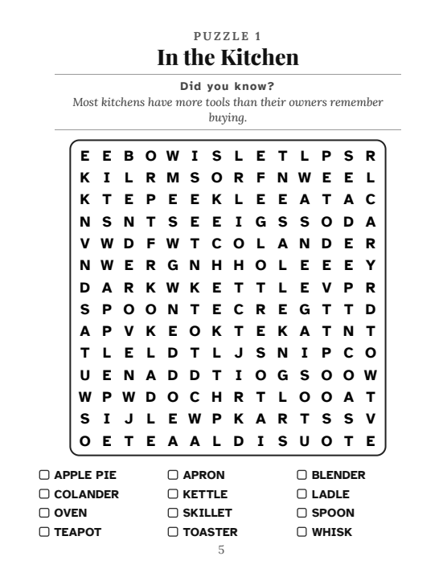
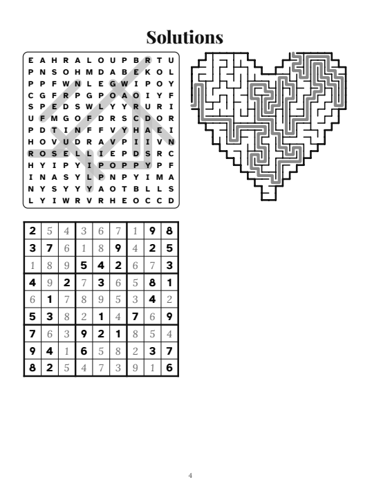

# KDP Puzzle Book Generator

Python toolkit that generates print-ready Amazon KDP interiors and full-wrap covers for word search, maze, sudoku, crossword and logic puzzle books, then preflights them against KDP's print rules.


<p>
  
  
</p>

## Features

- **Word search:** seeded grid generator (easy or all 8 directions), substring and profanity guards, SVG rendering, and a complete large-print book builder (title, copyright, how-to-play, contents, puzzles, solutions, notes pages).
- **Mazes:** perfect mazes in 20+ shapes (heart, star, cat, rocket...), adjustable straightness, start/end icons, solution path.
- **Sudoku:** unique-solution puzzles with symmetric givens.
- **Crossword:** American-style engine with symmetric block patterns, a backtracking filler over a bundled clue bank, and a verifier (every answer from the bank, no repeats, all cells checked).
- **Logic grids:** 3-category "who did it" mysteries, checked for exactly one solution and solvable by pure elimination.
- **Ciphers and word games:** A1Z26, Caesar shift, Polybius, Morse, pigpen glyphs, cryptograms, scrambles.
- **Covers:** full-wrap back + spine + front at the exact KDP size for any page count (bleed, spine width, safe areas).
- **Preflight (`qa`):** page size, even page count, embedded fonts, ink inside the edge/gutter bands, cover size, plain barcode zone, 16 pt large-print check.

Pages are built as HTML/SVG and printed to PDF with headless Chrome, so layout is plain CSS.

## Requirements

- Python 3.10+
- Google Chrome or Chromium (found on `PATH` or at the default install path; override with `CHROME_PATH`)

```bash
pip install -r requirements.txt
```

## Usage

```bash
# 4-page sampler: word search, heart maze, sudoku, solutions
python generate.py sampler -o output/sampler

# Large-print word search book from a JSON config
python generate.py wordsearch examples/wordsearch_book.json -o output/wordsearch

# Inspect a PDF (page count, size, font embedding) and render page 5 to PNG
python generate.py check output/wordsearch/interior.pdf --render 5

# KDP preflight for one or more book folders (interior.pdf, optional cover.pdf / listing.md)
python generate.py qa output/wordsearch
```

`examples/wordsearch_book.json` shows every config key the word search builder reads (title, subtitle, brand, intro paragraphs, and a list of `[title, fun fact, words]` puzzles).

### As a library

The modules in `kdp/` import each other by name, so put that folder on the path:

```python
import sys; sys.path.insert(0, "kdp")
from common import Book, html_to_pdf
from maze import Maze

maze = Maze("star", rows=24, cols=24, seed=3, straightness=0.3)
book = Book()
book.add(f"<h1>Star Maze</h1>{maze.svg(cell=20)}")
book.add(maze.svg(cell=20, solution=True))
open("maze.html", "w", encoding="utf-8").write(book.html("Star maze"))
html_to_pdf("maze.html", "maze.pdf")
```

`cover.build_cover(out_dir, pages, back_html, spine_html, front_html, bg_css)` writes `cover.pdf` at the exact wrap size for the interior's page count.

## Project structure

```
generate.py        command-line entry point
kdp/               generator modules (common, wordsearch, ws_book, maze, sudoku in puzzles,
                   crossword + xwbank clue bank, logic, ciphers, cover, cover_art, icons, portrait, qa, check_pdf)
assets/fonts/      bundled OFL fonts and licence
examples/          sample word search book config
docs/              sample output images
```

## Publishing note

Amazon KDP rejects or removes low-content books that duplicate existing ones. The generator makes original grids, but **your themes, word lists, clues, cover art and listing must be your own original work**, and you are responsible for following KDP's content guidelines.

## Fonts

Bundled fonts are under the SIL Open Font License 1.1. See [assets/fonts/README.md](assets/fonts/README.md) and [assets/fonts/OFL.txt](assets/fonts/OFL.txt).

## License

Code: MIT, see [LICENSE](LICENSE). Fonts: SIL OFL 1.1.

## Author

Taha Ilyas - [github.com/realtahailyas](https://github.com/realtahailyas)
